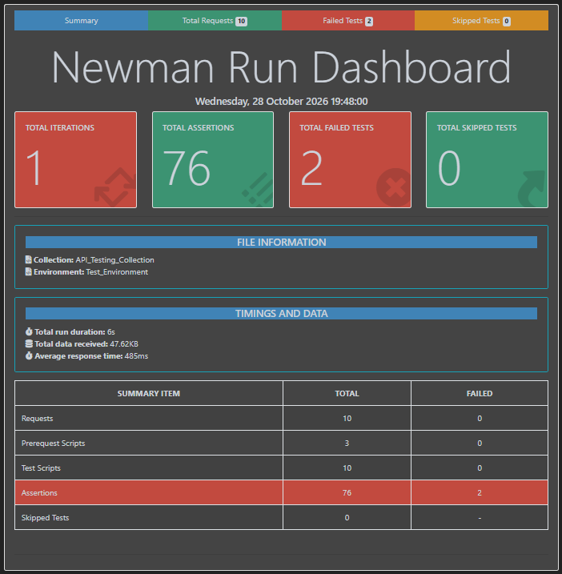

# RESTful Booker API Testing

## 📌 Project Overview
An API testing project using **Postman, JavaScript, and Newman** to validate the functionality, response status codes, response times, and data integrity of the [RESTful Booker API](https://restful-booker.herokuapp.com).

## 📊 Newman Test Execution Summary

**Execution Results**

| Metric | Result |
|---|---:|
| Total Requests | 10 |
| Total Assertions | 76 |
| Failed Assertions | 2 |
| Skipped Tests | 0 |
| Average Response Time | 485 ms |
| Total Execution Time | 6 seconds |

*The report shows two failed assertions related to expected HTTP status codes for booking creation and token generation.*

## 🛠️ Tools & Technologies
- **Postman** – API requests and test automation
- **JavaScript** – Pre-request scripts and test assertions
- **Newman** – Command-line execution and HTML reporting

## 🧪 Test Coverage
- Booking retrieval, creation, updating, partial updating, and deletion
- Authentication and token generation
- HTTP status code validation
- Response time and response size checks
- Response body and data integrity validation
- Dynamic test data generation and environment variables

## 📁 Project Files
- 📄 [**Postman Collection**](API_Testing_Collection.postman_collection.json) – API requests and automated test scripts
- ⚙️ [**Test Environment**](Test_Environment.postman_environment.json) – Environment configuration
- 📊 [**Newman HTML Report**](report.html) – Detailed test execution report
- 🖼️ [**Newman Run Summary**](Newman_Run_Summary.png) – Visual summary of test results

## ▶️ How to Run
1. Import the Postman collection and environment JSON files into Postman.
2. Select the imported environment.
3. Run the collection using the Collection Runner.
4. Open `report.html` in a browser to review the saved test results.

## 💡 Key Skills Demonstrated
- API Testing
- Test Automation
- JavaScript Assertions
- Environment Configuration
- Dynamic Test Data Generation
- Newman Reporting
